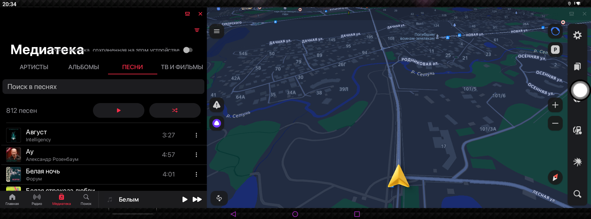

# Мультиокно (navisplit)

Мультиокно-лаунчер для Android-бокса без панели задач. Одним тапом открывает два приложения
**бок о бок** в freeform-окнах («сплит»), например Навигатор слева (65%) и музыка справа (35%).
Работает и с приложениями, которые **уже запущены**, и **без root**.

Текущая версия: **1.2.0** (versionCode 3) · история версий — [CHANGELOG.md](CHANGELOG.md)



## Возможности

- Сценарии: любая пара приложений + раскладка 50/50, 65/35, 35/65, 60/40, 40/60.
- Плитки сценариев на рабочий стол (виджет «Мультиокно»), тап = запуск.
- Виджет **«Мультиокно: закрыть окна»** и кнопка «✕ Закрыть все окна» в приложении: закрывает окна,
  приложения при этом не убиваются (навигация и музыка продолжают работать).
- Перетайливание уже запущенных приложений: окно переезжает на нужное место, состояние не теряется.
- После перезагрузки бокса приложение само включает отладку по Wi-Fi (нужна для работы без root).

## Что нужно для запуска

**На боксе**

| Требование | Зачем |
|---|---|
| Android 10+ (проверено на Android 13 / API 33, 1920×716) | freeform-окна |
| Включённый режим разработчика и **отладка по USB** | adb-канал, через который приложение управляет окнами |
| **Отладка по Wi-Fi** (беспроводная отладка) | при первом подключении и установке с компьютера |
| Включённый freeform (`enable_freeform_support`, `force_resizable_activities`) | см. шаг 1 ниже |

**На компьютере** (только для установки и сборки)

- macOS (сборка и `fetch-toolchain.sh` рассчитаны на macOS), интернет для первой сборки (~660 МБ тулчейна).
- Компьютер и бокс в **одной сети/на одном хотспоте**. Root не нужен.

## Установка по шагам

> Дальше `ADB` — путь к `adb`: `toolchain/platform-tools/adb` после первой сборки, либо любой другой adb.
> `<IP>` — адрес бокса (в настройках сети или на роутере). Он может меняться при смене хотспота.

**1. Один раз включить freeform на боксе** (переживает перезагрузку, сбрасывается только сбросом к заводским):

```bash
ADB=toolchain/platform-tools/adb
$ADB connect <IP>:5555
$ADB shell settings put global enable_freeform_support 1
$ADB shell settings put global force_resizable_activities 1
$ADB reboot    # обязательно
```

**2. Получить APK.** Либо взять готовый `navisplit.apk` из репозитория, либо собрать:

```bash
bash build.sh        # результат: navisplit.apk в корне
```

Первая сборка сама скачает тулчейн (JDK 17 + Android SDK) в `./toolchain`.

**3. Установить:**

```bash
$ADB connect <IP>:5555
$ADB install -r navisplit.apk
```

**4. Выдать права на автовключение отладки (один раз):**

```bash
$ADB shell pm grant com.artman.navisplit android.permission.WRITE_SECURE_SETTINGS
```

Зачем: бокс сбрасывает «Отладку по Wi-Fi» при каждой загрузке. Без этого права после перезагрузки
её придётся включать вручную в настройках. Право сохраняется между перезагрузками и обновлениями
APK с той же подписью. После **переустановки с другой подписью** выдайте его заново.

**5. Первый запуск.**
1. Откройте «Мультиокно» на боксе, создайте сценарии («＋ Новый сценарий»: название, левое окно,
   правое окно, раскладка). Короткий тап по сценарию запускает его, долгий — правка или удаление.
2. При первом тапе приложение подключится к adb бокса. Если на экране появится запрос
   «Разрешить отладку?», нажмите «Всегда разрешать» (на проверенной прошивке запрос принимается
   автоматически). Внизу экрана появится сообщение «Подтвердите отладку на экране бокса».

**6. Виджеты на рабочий стол** (Nova и др.): добавьте виджет «Мультиокно» и выберите сценарий.
Для закрытия окон добавьте виджет **«Мультиокно: закрыть окна»** (настройка не нужна).

### Обновление

```bash
$ADB install -r navisplit.apk    # сценарии и виджеты сохраняются
```

## Как это работает

Запуск пары идёт по первому доступному каналу (`Launcher.java`):

1. **root (`su`)**, если он есть;
2. **adb-shell**: приложение само подключается к adbd бокса на `127.0.0.1:5555` (встроенный
   adb-клиент `Adb.java`) и выполняет команды от пользователя `shell`;
3. **резерв**: `ActivityOptions.setLaunchBounds` + скрытый `setLaunchWindowingMode`. Тайлит **только
   приложения, которые ещё не запущены** (для запущенной задачи bounds игнорируются).

Рецепт для запущенных приложений (два шага, именно в таком порядке):

```
am start --windowingMode 5 -n <компонент>      # перевод задачи в freeform
am task resize <taskId> L T R B                # границы через пробел
```

`am task resize` — no-op, если задача ещё не freeform, поэтому сначала режим окна. Закрытие окон:
`am stack remove <id>` для каждого freeform-стека из `am stack list`.

Границы: верх под статус-баром, низ над панелью ◁○□. Панель на этом боксе рисует сторонний оверлей
`nu.nav.bar` высотой 32 dp, система её не сообщает, поэтому высота задана константой
`OVERLAY_NAV_BAR_DP` в `Launcher.java`. На другом боксе поправьте её.

После загрузки `BootReceiver` выставляет `adb_wifi_enabled=1` (нужно право `WRITE_SECURE_SETTINGS`).

`targetSdkVersion=25` — **обязательное условие**: так приложению доступен скрытый
`setLaunchWindowingMode`. Не поднимайте до 33, иначе тайлинг через резервный путь сломается.

## Если что-то не работает

| Симптом | Что проверить |
|---|---|
| `adb connect` пишет `Connection refused` | Отладка по Wi-Fi выключена. Включите в настройках разработчика. Если право из шага 4 выдано, после перезагрузки она включится сама через ~1 мин |
| `unauthorized` | На боксе подтвердите ключ («Всегда разрешать») или `adb kill-server && adb start-server` и повторите подключение |
| `device offline` / `No route to host` | Бокс сменил IP/сеть. Подключите компьютер и бокс к одному хотспоту, `adb disconnect`, `adb connect <IP>:5555` |
| Плитка открывает приложения на весь экран, окна не делятся | Не включён freeform (шаг 1) или не было перезагрузки; либо нет канала shell (проверьте `adb logcat -s navisplit`) |
| Окна заходят под панель ◁○□ | Подберите `OVERLAY_NAV_BAR_DP` в `Launcher.java` |
| Сообщение «Окно не найдено: …» | Приложение не успело открыть окно за 3 с. Повторите тап; в логе `navisplit` — `no taskId` |
| Нужно посмотреть, что происходит | `adb logcat -s navisplit` |

Ручная проверка канала: `adb shell am stack list` должен показать окна, а команды из раздела
«Как это работает» работают и вручную.

## Известные ограничения

- Без shell/root (нет доступа к adbd) работает только резервный путь: запущенные приложения не
  перетайливаются.
- При смене Wi-Fi-сети Android может выключить беспроводную отладку; перезагрузка бокса или
  ручное включение вернёт её. Приложение обращается к `127.0.0.1`, но сам adbd должен слушать порт 5555.
- Закрытие окна не останавливает приложение (процесс остаётся). Для полной остановки используйте
  настройки Android («Остановить»).
- Split-разделитель (общая рамка для перетаскивания) с кастомным HOME без root невозможен:
  Overview привязан к Quickstep-как-HOME.

## Устройство, на котором всё проверено

| Параметр | Значение |
|---|---|
| Модель | CarPlay-бокс `XQ_CarPlayBox1` (плата APM-6125-T7-Dual-V1.0), SoC Qualcomm SM6125 (`trinket`), модем SIMCom SIM8971 |
| Android | 13 (API 33), строка release=14 фейковая; `user`, `release-keys` |
| Экран | 1920 × 716, landscape, панель ◁○□ — оверлей `nu.nav.bar` |
| Root | нет; загрузчик разблокирован (`orange`), слот `_b` |
| HOME | Nova (`com.teslacoilsw.launcher`), штатный `launcher3` отключён |
| USB | USB-контроллер `dwc3` работает в режиме **host** (Wi-Fi Realtek подключён к нему); к компьютеру бокс по USB-C как устройство не определяется. Поэтому весь путь без USB: adb по Wi-Fi |
| adb | по Wi-Fi, порт 5555 |

## Структура проекта

```
app/
  AndroidManifest.xml                  versionCode/versionName; targetSdk=25 (важно); разрешения; виджеты
  src/com/artman/navisplit/
    MainActivity.java                  UI: сценарии, редактор, «Закрыть все окна», версия
    Scenario.java / Store.java         модель сценария и хранение (SharedPreferences/JSON, привязка виджетов)
    Launcher.java                      выбор канала (su → adb → резерв), тайлинг, закрытие окон, границы
    Adb.java                           встроенный adb-клиент (CNXN/AUTH/RSA, shell:) на 127.0.0.1:5555
    BootReceiver.java                  включает adb_wifi_enabled после загрузки
    LaunchActivity.java                прозрачный триггер для виджетов (запуск сценария / закрытие окон)
    WidgetProvider.java                виджет-плитка сценария
    WidgetConfigActivity.java          выбор сценария при размещении виджета
    CloseWidgetProvider.java           виджет «закрыть окна»
  res/                                 layout/drawable/xml виджетов
build.sh                               самодостаточная сборка → navisplit.apk
fetch-toolchain.sh                     скачивает JDK 17 + Android SDK в ./toolchain (в git не входит)
navisplit.apk                          последняя сборка
CHANGELOG.md                           история версий
screenshots/                           скриншоты с бокса
```

## Сборка и версионирование

```bash
bash build.sh
```

Версия задаётся в `app/AndroidManifest.xml`: `versionName` (1.2.0) и `versionCode` (растёт на 1 с каждым
релизом). Релизы помечены git-тегами `vX.Y.Z`. Что изменилось между версиями — в
[CHANGELOG.md](CHANGELOG.md).

## Запасной вариант

Taskbar (`com.farmerbb.taskbar`) тоже может открывать freeform-окна, но UX неудобный; это приложение
его заменяет.
